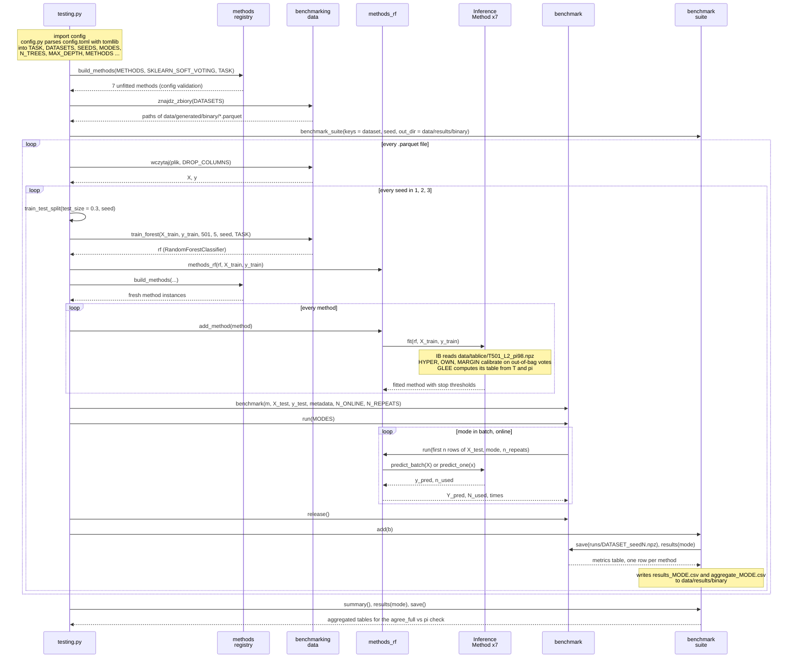

# Data flow of one benchmark run

UML sequence diagram of `src/testing.py` for the configuration currently in `config.toml`:
`task = "classification"`, `datasets = ["generated/binary"]`, `seeds = [1, 2, 3]`,
`modes = ["batch", "online"]`, a forest of 501 trees with `max_depth = 5`, and seven enabled
methods (`rf_sklearn`, `full_voting`, `IB_pi98`, `HYPER_pi98`, `GLEE_pi98`, `MARGIN_k0`,
`OWN_lam0.5_pi98`).

## What travels along the arrows

| Data | Produced by | Consumed by |
|---|---|---|
| Constants (`TASK`, `DATASETS`, `SEEDS`, `MODES`, `N_TREES`, `MAX_DEPTH`, `METHODS`, ...) | `config.py` from `config.toml` | `testing.py` only; `methods` and `benchmarking` never read the config |
| `list[InferenceMethod]` (unfitted) | `registry.build_methods`: one `[[methods]]` block becomes one constructor call, `rf_sklearn` is prepended when `sklearn_soft_voting = true`, blocks with `enabled = false` or of the other task are skipped | `methods_rf.add_method` |
| `X, y` | `data.wczytaj` from a `.parquet` file | `train_test_split` |
| `rf` | `data.train_forest` on `X_train, y_train` | `methods_rf`, then every method's `fit` |
| Stop thresholds (`prog`, `voters`) | each method's `fit`: IB from a `.npz` table, HYPER/OWN/MARGIN from out-of-bag predictions on `X_train`, GLEE from `T` and `pi` | `predict_batch` / `predict_one` |
| `Y_pred, N_used, times` (one row per method) | `methods_rf.run` on `X_test` | `benchmark._compute_results` |
| Metrics table (accuracy, f1, `agree_*`, `speedup_vs_*`, `trees_*`) | `benchmark.results(mode)` using `y_test` | `benchmark_suite`, which writes `runs/*.npz`, `results_*.csv`, `aggregate_*.csv` |
